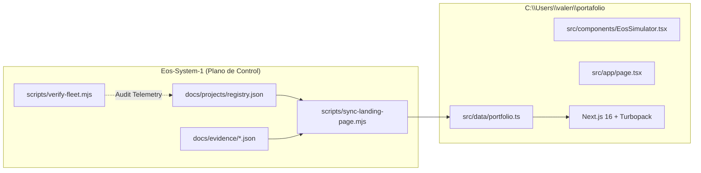

# PLAN-005: EOS & LANDING PAGE CONTINUOUS CO-EVOLUTION PLAN
## Architecture Plan & Architectural Decision Records (ADR)

---

### 1. ARQUITECTURA DEL PUENTE DE CO-EVOLUCIÓN

---

### 2. ARCHITECTURAL DECISION RECORDS (ADR)

#### ADR-005-01: Script de Sincronización Declarativa de Metadatos (`sync-landing-page.mjs`)
* **Contexto:** Mantener la landing page sincronizada con el ritmo veloz de innovación en EOS requiere automatización libre de deriva manual.
* **Decisión:** Implementar un script de sincronización en Node.js puro (`scripts/sync-landing-page.mjs`) que lee la fuente de verdad (`docs/projects/registry.json`) e inyecta quirúrgicamente las estadísticas de la flota, las características de Aberamentho 10/10 y las especificaciones de EOS Core 2.1 en `portfolio.ts`.
* **Alternativas Rechazadas:**
  * *Fetch en Runtime en la Landing Page:* Rechazado porque añadiría llamadas HTTP de red que degradarían el Time To First Byte (TTFB) y violarían la independencia estática del portafolio.
  * *Actualización Manual de Texto:* Rechazada por infringir el Mandamiento I (Zero Vibe Coding) y producir desfases informativos frecuentes.

#### ADR-005-02: Actualización de Telemetría de Aberamentho en la Landing Page
* **Contexto:** Aberamentho ha alcanzado 47 artistas, grabación Hi-Fi, jog wheel nudge y `navigator.mediaSession`.
* **Decisión:** Actualizar los textos, métricas, badges y viñetas en `portfolio.ts` para proyectar el pináculo tecnológico alcanzado.
