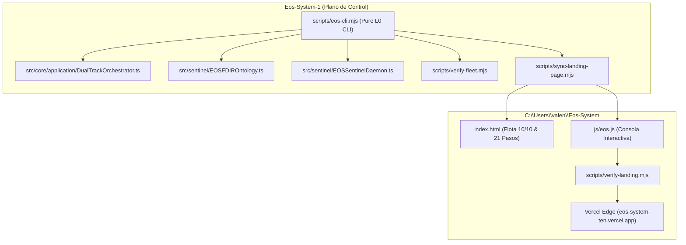

# PLAN-006: ARCHITECTURE PLAN & ADR FOR EOS CLI & PORTAL
## Architectural Decisions and Evolution Strategy

---

### 1. ARQUITECTURA DE LA CLI Y EL PORTAL WEB

---

### 2. ARCHITECTURAL DECISION RECORDS (ADR)

#### ADR-006-01: Implementación de CLI en Pure Node.js ES Modules (L0)
* **Contexto:** Mantener el Mandamiento V (Pureza Arquitectónica L0 con 0 dependencias externas) en la herramienta de línea de comandos.
* **Decisión:** Implementar `scripts/eos-cli.mjs` usando exclusivamente módulos nativos (`node:fs`, `node:path`, `node:child_process`, `node:crypto`).
* **Consecuencias:** Máxima portabilidad, arranque instantáneo en menos de 10ms, cero fricción de instalación.

#### ADR-006-02: Consola Interactiva en el Portal Web con Simulación Dual-Track
* **Contexto:** El portal público `eos-system-ten.vercel.app` debe ser una experiencia viva e interactiva del poder de EOS.
* **Decisión:** Agregar los comandos `dualtrack:orchestrator` y `attestation:chain` a `js/eos.js` y botones de acceso rápido en `index.html`.
