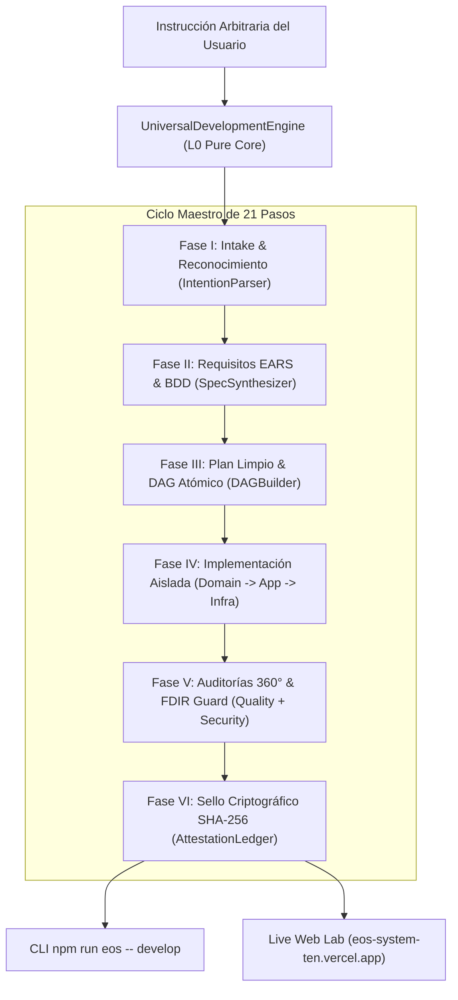

# PLAN-007: EOS UNIVERSAL DEVELOPMENT ENGINE PLAN
## Architecture Plan & Architectural Decision Records (ADR)

---

### 1. ARQUITECTURA DEL MOTOR UNIVERSAL

---

### 2. ARCHITECTURAL DECISION RECORDS (ADR)

#### ADR-007-01: Dominio Puro y Motor de Síntesis Sin Dependencias de NPM
* **Contexto:** El motor debe poder ejecutarse en cualquier entorno (Node.js, Edge runtime, CLI, CI/CD) sin requerir librerías pesadas ni vendor lock-in.
* **Decisión:** Implementar `UniversalDevelopmentEngine.ts` y sus modelos de soporte (`AgentRoleMatrix.ts`, `IntentionParser.ts`) en TypeScript puro sin dependencias externas de runtime.
* **Alternativas Rechazadas:**
  * *Usar frameworks de agentes pesados en runtime:* Rechazado por violar el Mandamiento V (Hexagonal L0 Purity) e introducir vulnerabilidades en la cadena de suministro.

#### ADR-007-02: Matriz de 8 Roles Especializados de Agentes
* **Contexto:** La ejecución perfecta de cualquier desarrollo requiere separar responsabilidades (Principio de Responsabilidad Única y separación de preocupaciones).
* **Decisión:** Modelar formalmente los 8 roles de agentes que colaboran en el pipeline: `Architect`, `RequirementsEngineer`, `DomainCoder`, `SecurityAuditor`, `QualityAuditor`, `EvidenceAuditor`, `Deployer`, `SyncMaster`.
