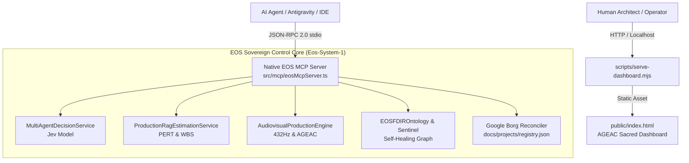

# PLAN-012: Architecture Plan & ADR — EOS Unified Sovereign Control Hub & Native MCP Gateway

* **Status:** PLAN_APPROVED
* **Author:** Lead Systems Architect & Valentin Florez
* **Target:** `src/mcp/eosMcpServer.ts`, `public/index.html`, `scripts/serve-dashboard.mjs`

---

## 1. System Architecture Diagram

---

## 2. ADR-012: Native Zero-Dependency Stdio MCP Server & Embedded Control Dashboard

### Context
External agents require real-time access to EOS capabilities via the Model Context Protocol (MCP). The previous external MCP server was decoupled from the primary repository and suffered from state drift (100% drift on Borg reconciliation). Simultaneously, human operators require an immediate, interactive dashboard that visualizes Cymatics, PERT curves, and multi-agent consensus in real-time.

### Decision
1. Implement `src/mcp/eosMcpServer.ts` directly in `Eos-System-1` using pure Node.js stdio (Layer 0/1 compliance).
2. Wire all domain models (`DecisionArbiter`, `RagEstimationEngine`, `SacredDesignSystem`, `EOSFDIROntology`) directly into MCP tool handlers.
3. Build a self-contained, aesthetic dashboard in `public/index.html` with vanilla JavaScript and CSS, adhering to the Sacred Design System (`#962733`, `#C59B27`, `#080D14`, `#FBF9F4`).
4. Provide `scripts/serve-dashboard.mjs` using Node.js `http` module for zero-dependency execution on `npm run dashboard`.

### Rejected Alternatives
* **Alternative A: Heavy npm MCP Framework (`@modelcontextprotocol/sdk` + Express).**
  - *Rejection Reason:* Violates Law V (Domain & App Layer Purity) by introducing hundreds of transitive npm dependencies and potential supply chain vulnerabilities. A clean standard JSON-RPC stdio loop is robust, auditable, and takes <10ms to initialize.
* **Alternative B: React / Next.js SPA for the Dashboard.**
  - *Rejection Reason:* Introduces heavy build steps and dev server friction for a control dashboard. A clean, vanilla, responsive single-page application with modern CSS grid/flex and Canvas API delivers instantaneous 60 FPS rendering with zero build lag.
