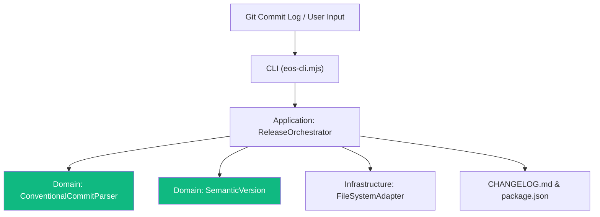

# PLAN-014: Architectural Plan — Semantic Versioning & Changelog Engine

* **Status:** PLAN_APPROVED
* **Specification:** [SPEC-014](file:///c:/Users/valen/Eos-System-1/docs/specs/SPEC-014-SEMANTIC-VERSIONING.md)

---

## 1. Architectural Strategy (Hexagonal Clean Architecture)

### Layer 0: Pure Domain Models
- `SemanticVersion.ts`: Immutably parses, compares, formats, and bumps versions according to SemVer 2.0.0.
- `ConventionalCommitParser.ts`: Immutably parses commit headers/bodies/footers, extracts breaking flags, and computes recommended semantic delta.

### Layer 1: Application Service
- `ReleaseOrchestrator.ts`: Orchestrates changelog synthesis, version calculation, file mutations (`package.json`, `CHANGELOG.md`), and dry-run summaries.

### Layer 2: Infrastructure & Presentation
- `eos-cli.mjs`: CLI command `eos release [major|minor|patch|auto] [--dry-run]`

---

## 2. Architectural Decision Records (ADRs)

### ADR-014-01: In-House Pure Domain SemVer vs External `semver` npm package
* **Status:** ACCEPTED
* **Context:** Node.js projects often pull in the `semver` npm package.
* **Decision:** Implement pure domain `SemanticVersion.ts` without external dependencies.
* **Rejected Alternative:** Installing `npm i semver`.
* **Rationale:** Violates Commandment V (Domain Purity). Pure TypeScript SemVer calculation is < 150 lines of code, completely deterministic, zero-dependency, and has zero supply-chain risk.

### ADR-014-02: Conventional Commit Specification Compliance
* **Status:** ACCEPTED
* **Context:** Need standardized commit parsing without dragging heavy AST parser libraries.
* **Decision:** Implement regex-based parser strictly following the Conventional Commits 1.0.0 specification with breaking change indicator (`!`) and footer (`BREAKING CHANGE:`).
* **Rejected Alternative:** Using `@commitlint/parse` or `conventional-changelog`.
* **Rationale:** Keeps EOS autonomous and hermetic without hundreds of nested node_modules dependencies.
