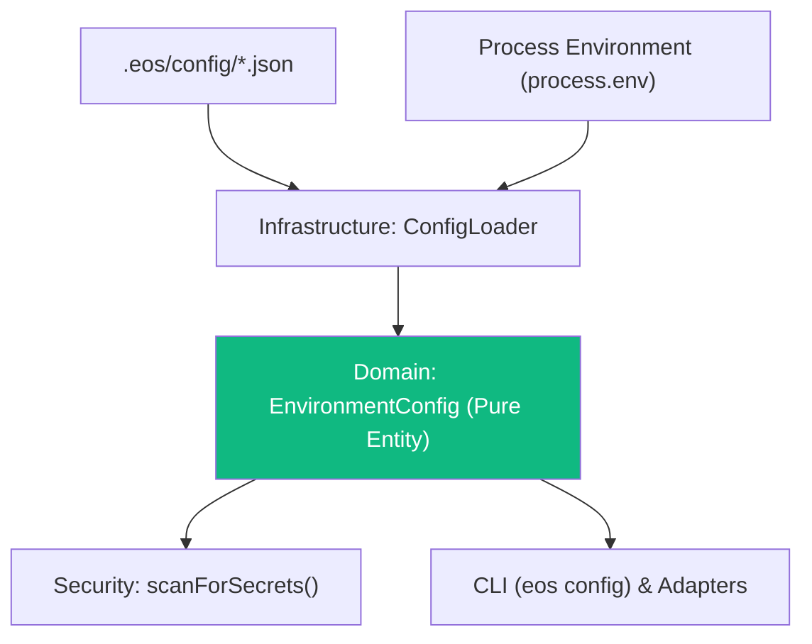

# PLAN-015: Architectural Plan — Runtime Configuration & Environment Management

* **Status:** PLAN_APPROVED
* **Specification:** [SPEC-015](file:///c:/Users/valen/Eos-System-1/docs/specs/SPEC-015-RUNTIME-CONFIG.md)

---

## 1. Architectural Strategy (Hexagonal Clean Architecture)

### Layer 0: Pure Domain Entity
- `EnvironmentConfig.ts`:
  - Contains immutable configuration state.
  - Resolves `${VAR}` and `$ENV{VAR}` placeholders.
  - Implements `scanForSecrets()` using entropy analysis and regex heuristics for high-risk tokens (AWS, GitHub, Google, Bearer, Private Keys).
  - Validates profile requirements.

### Layer 2: Infrastructure Adapter
- `ConfigLoader.ts`:
  - Reads `.eos/config/default.json` and optional `<profile>.json`.
  - Performs recursive object merge.
  - Injects environment variables.

### Layer 3: Presentation / CLI
- `eos config [show|validate|switch]` in `scripts/eos-cli.mjs`.

---

## 2. Architectural Decision Records (ADRs)

### ADR-015-01: Zero-Dependency Config Resolution vs `dotenv` / `convict`
* **Status:** ACCEPTED
* **Context:** Need robust configuration without adding bloated third-party dependencies.
* **Decision:** Implement pure domain configuration parser and regex expansion directly in TypeScript.
* **Rejected Alternative:** `dotenv`, `convict`, `dotenv-expand`.
* **Rationale:** Reduces attack surface, eliminates supply-chain risks, and preserves strict Layer 0 pure domain isolation.

### ADR-015-02: Defensive Plaintext Secret Scanning
* **Status:** ACCEPTED
* **Context:** Developers or agents could accidentally commit hardcoded tokens into configuration files.
* **Decision:** Embed a lightweight regex and Shannon entropy scanner in `EnvironmentConfig.ts` to reject plaintext tokens during config validation.
* **Rejected Alternative:** Relying solely on external pre-commit hooks.
* **Rationale:** Fail-safe at runtime before configuration is ever utilized by any application adapter or service.
