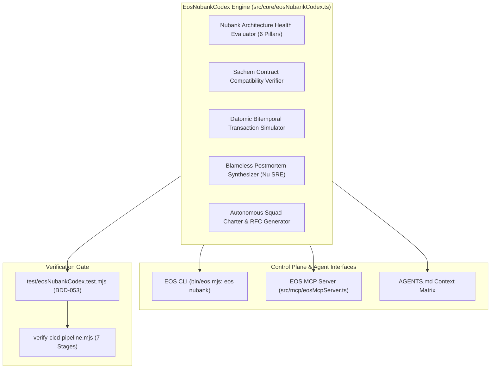

# ARCHITECTURE PLAN & ADR: NUBANK INSTITUTIONAL ENGINEERING CODEX (PLAN-016)
<!-- Standard: IEEE 830 / ISO 29148 — EOS 21-Step Master Pipeline -->

## 1. Architectural Decision Record (ADR-030)

### Context
EOS System coordinates multi-agent workflows, control-plane governance, and distributed service fleet operations.
To operate with institutional perfection at the level of Nu (Nubank) as documented on `https://building.nu.com/`, EOS requires a native Layer-0 module that codifies:
1. Nu's functional programming principles and complexity reduction metrics.
2. Datomic bitemporal transaction semantics and time-travel query models.
3. Consumer-Driven Contract testing (`Sachem` pattern) across asynchronous events.
4. Kafka partitioning and banking-grade idempotency deduplication.
5. Blameless incident management and postmortem generation according to Nu SRE guidelines.
6. Autonomous squad governance (Squad Charters, RFC-driven consensus, Runbooks).

### Alternatives Considered & Rejected
1. **Ad-hoc Markdown Guidelines Only**:
   - *Rejected*: Passive documentation fails to enforce runtime and CI/CD verification gates. Violates EOS Law I (Zero Vibe Coding) and Law III (Evidence Over Claims).
2. **Third-Party Clojure / JVM Runtime Dependency**:
   - *Rejected*: Introducing a JVM or Clojure runtime dependency directly into the Node.js Layer-0 control plane violates EOS Law V (Layer-0 Hexagonal Isolation with `dependencies: {}`).
3. **Heavy End-to-End Staging Integration Testing**:
   - *Rejected*: As proven by Nubank's engineering evolution (*Building Nu*), cross-service E2E staging environments create flaky test runs, synchronization bottlenecks, and high infrastructure costs. Consumer-Driven Contracts (`Sachem`) with schema evolution validation provide superior deterministic safety.

### Decision
Implement `EosNubankCodex` in pure Layer-0 TypeScript (`src/core/eosNubankCodex.ts`) with zero runtime dependencies:
1. **Architectural Health Evaluator**: Audits codebases against the 6 Building Nu pillars (0-100 score).
2. **Sachem Contract Compatibility Verifier**: Enforces backward compatibility rules on API/Kafka event schemas (additive optional fields allowed, breaking field type changes or removals rejected).
3. **Datomic Bitemporal Transaction Simulator**: Simulates immutable Datom assertions and retractions with monotonic transaction times and Merkle hash verification.
4. **Institutional Blameless Postmortem Synthesizer**: Formulates structured, blameless postmortem reports featuring timeline reconstruction, the 5 Whys, cognitive load analysis, and corrective action items with owners and deadlines.
5. **Squad Charter & RFC Generator**: Generates autonomous squad definitions with service catalogs, SLIs/SLOs, and RFC consensus templates.

---

## 2. Component Architecture Diagram

