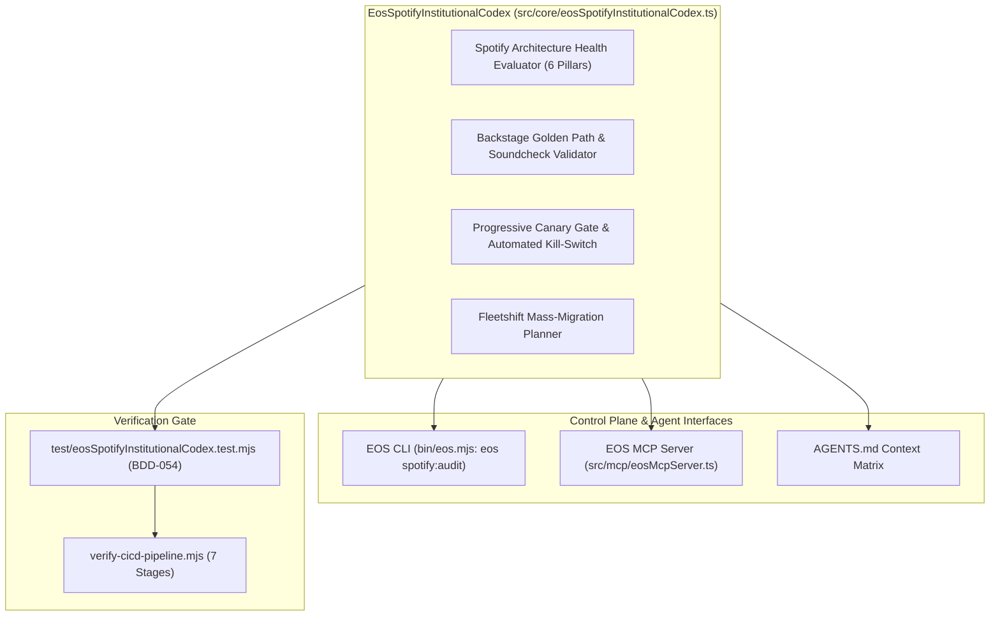

# ARCHITECTURE PLAN & ADR: SPOTIFY INSTITUTIONAL ENGINEERING CODEX (PLAN-017)
<!-- Standard: IEEE 830 / ISO 29148 — EOS 21-Step Master Pipeline -->

## 1. Architectural Decision Record (ADR-031)

### Context
EOS System coordinates multi-agent control-plane governance, distributed fleets, and real-time audio systems.
To operate with institutional perfection at the level of Spotify R&D as documented on `https://engineering.atspotify.com/`, EOS requires a native Layer-0 module that codifies:
1. The 6 Pillars of Spotify Engineering (Golden Paths & Soundcheck, Aligned Autonomy, Event Delivery at Scale, Audio BS.1770 DSP, Progressive Canary Delivery, and Fleetshift/Blameless SRE).
2. Soundcheck-grade Golden Path compliance scoring (0-100).
3. Automated progressive canary rollout gating with Prometheus fail-closed thresholds.
4. Fleetshift mass-migration planning for multi-repository fleets.
5. ITU-R BS.1770 audio loudness verification and True Peak ceiling limiting.

### Alternatives Considered & Rejected
1. **Relying Only on Ad-hoc Audio Scripts**:
   - *Rejected*: Lacks institutional governance of developer experience, Backstage catalogs, and canary progressive delivery.
2. **Third-Party Heavy SRE / Rollout Frameworks**:
   - *Rejected*: Introducing third-party Node.js dependencies violates EOS Law V (Layer-0 Hexagonal Isolation with `dependencies: {}`).
3. **Unchecked Canary Rollouts without Automated Kill-Switches**:
   - *Rejected*: Violates Spotify's blast-radius containment principles where any anomalous error rate (> 0.1%) or latency spike must trigger an instantaneous automatic rollback.

### Decision
Implement `EosSpotifyInstitutionalCodex` in pure Layer-0 TypeScript (`src/core/eosSpotifyInstitutionalCodex.ts`) with zero runtime dependencies:
1. **Spotify Architecture Health Evaluator**: Audits any repository against the 6 pillars of `engineering.atspotify.com` (0-100 score).
2. **Backstage Golden Path & Soundcheck Validator**: Evaluates `catalog-info.yaml`, TechDocs, SRE runbooks, and telemetry hooks.
3. **Progressive Canary Gate**: Evaluates real-time canary metrics (error rate, p99 latency, rollback criteria) against progressive traffic steps.
4. **Fleetshift Migration Planner**: Plans multi-repo batch migrations, computing affected repos, dependencies, and PR branch topologies.

---

## 2. Component Architecture Diagram

