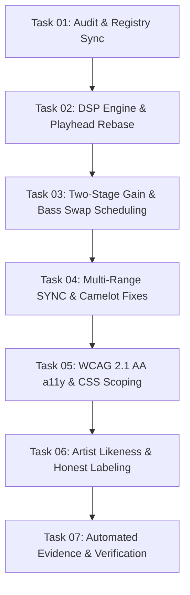

# TASKS-004: ABERAMENTHO PERFECTION ATOMIC TASK DAG

| Task ID | Description | Layer | Target Files | Done Criteria |
|---|---|---|---|---|
| **TASK-01** | Synchronize `AUDIT-004` and `registry.json` status | Docs / Governance | `docs/projects/registry.json` | Status reflected as `REMEDIATION_IN_PROGRESS` |
| **TASK-02** | Implement persistent `AudioContext` lifecycle and playhead rebase math | Application / DSP | `src/audio/audio-context.js` | Zero playhead jump on tempo shift |
| **TASK-03** | Implement two-stage gain staging and hardware clock Bass Swap | Application / DSP | `src/audio/audio-context.js`, `src/audio/automix-brain.js` | Auto-gain preserved during fader changes; sample-accurate kill |
| **TASK-04** | Multi-range pitch slider (±8%, ±16%, ±50%) & strict Camelot | UI / Domain | `src/ui/deck-controller.js`, `src/audio/camelot-engine.js` | Full sync range covered; invalid keys return unknown |
| **TASK-05** | Add `aria-label` to sliders, Escape close to modal, scope CSS classes | Presentation / a11y | `index.html`, `app.js`, `style.css` | 0 a11y slider findings; modal closes on Esc |
| **TASK-06** | Replace misattributed artist likenesses and clarify audio sources | Presentation / Content | `src/audio/playlist-vault.js`, `index.html` | Genuine artist imagery; transparent Spotify/Cabina demarcation |
| **TASK-07** | Browser E2E revalidation and evidence generation | Evidence | `docs/evidence/EVD-0004-ABERAMENTHO-PASS.json` | 100% checks passing; exit code 0 |
