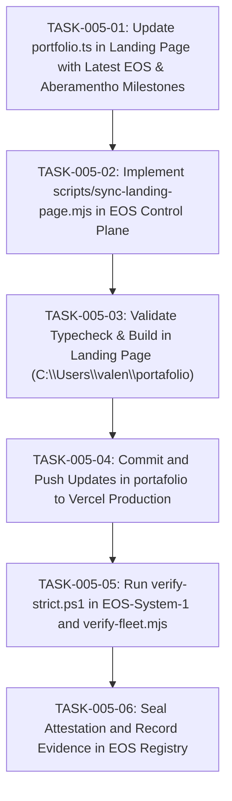

# TASKS-005: ATOMIC DAG BREAKDOWN
## Pipeline de Tareas Atómicas para Sincronización Continua

---

---

### TABLA DE DEFINICIÓN DE TAREAS

| ID | Descripción | Insumo | Criterio de Hecho |
|---|---|---|---|
| `TASK-005-01` | Actualizar `portfolio.ts` con hitos de Aberamentho 10/10 y EOS 2.1 | `portfolio.ts`, `registry.json` | 47 leyendas, grabación Hi-Fi, mediaSession reflejados |
| `TASK-005-02` | Crear `scripts/sync-landing-page.mjs` en EOS | `registry.json`, `verify-fleet.mjs` | Script de sincronización ejecutable |
| `TASK-005-03` | Validar compilación de `portafolio` | `next build` / TypeScript | 0 errores de tipado o compilación |
| `TASK-005-04` | Commit y push de `portafolio` | Git | Commit en `main` desplegado a Vercel |
| `TASK-005-05` | Ejecución de `verify-strict.ps1` y `verify-fleet.mjs` | Scripts de verificación | Exit code 0 en ambas suites |
| `TASK-005-06` | Sellado de evidencia y actualización de registro | `registry.json`, `EVD-0001` | Registro actualizado con nuevo hash |
