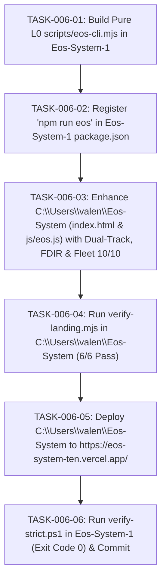

# TASKS-006: ATOMIC DAG BREAKDOWN
## Pipeline de Tareas Atómicas para EOS CLI y Portal en Vivo

---

---

### TABLA DE DEFINICIÓN DE TAREAS

| ID | Descripción | Criterio de Hecho |
|---|---|---|
| `TASK-006-01` | Construir `scripts/eos-cli.mjs` | Comandos `status`, `dual-track`, `sentinel`, `fdir`, `sync`, `deploy` ejecutables |
| `TASK-006-02` | Registrar `"eos": "node ./scripts/eos-cli.mjs"` | `npm run eos -- status` operativo con exit code 0 |
| `TASK-006-03` | Enriquecer portal web `C:\Users\valen\Eos-System` | Comandos `dualtrack:orchestrator` y `attestation:chain` activos |
| `TASK-006-04` | Auditoría de invariantes de portal | `verify-landing.mjs` pasa 6/6 |
| `TASK-006-05` | Despliegue en producción de portal | `npx vercel --prod --yes` con HTTP 200 en `eos-system-ten.vercel.app` |
| `TASK-006-06` | Verificación estricta del plano de control | `verify-strict.ps1` exit code 0 y commit sellado |
