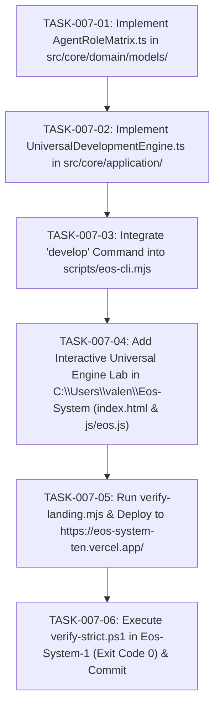

# TASKS-007: ATOMIC DAG BREAKDOWN
## Pipeline de Tareas Atómicas para el Motor de Desarrollo Universal

---

---

### TABLA DE DEFINICIÓN DE TAREAS

| ID | Descripción | Insumo | Criterio de Hecho |
|---|---|---|---|
| `TASK-007-01` | Crear `AgentRoleMatrix.ts` | `types.ts`, Constitución Sec. 3 | 8 roles definidos con capacidades y verificaciones |
| `TASK-007-02` | Crear `UniversalDevelopmentEngine.ts` | Modelos de dominio | Motor de 21 pasos ejecutable con EARS/BDD |
| `TASK-007-03` | Integrar comando `develop` en CLI | `eos-cli.mjs` | `npm run eos -- develop "<prompt>"` operativo |
| `TASK-007-04` | Agregar simulador universal al portal web | `index.html`, `js/eos.js` | Laboratorio interactivo activo en `#desarrollo-universal` |
| `TASK-007-05` | Auditoría y despliegue a producción | `deploy-portal.mjs` | `verify-landing.mjs` 6/6 Pass & Vercel HTTP 200 |
| `TASK-007-06` | Verificación estricta de plano de control | `verify-strict.ps1` | Exit Code 0 & commit sellado en `Eos-System-1` |
