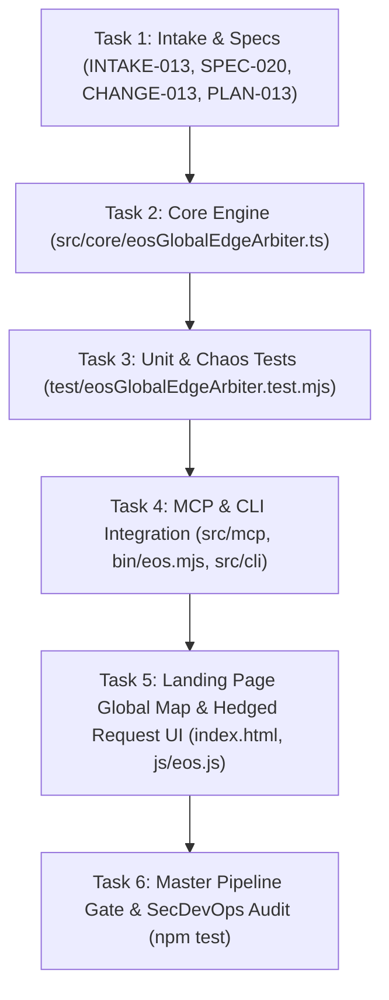

# ATOMIC TASK DAG: GLOBAL EDGE ANYCAST ARBITER & SPEED MESH (TASKS-013)

## Task Checklist
- [x] Task 1: Record Intake, Specifications, Change Proposal, and ADR.
- [ ] Task 2: Implement `EosGlobalEdgeArbiter` with 8 POPs, Haversine RTT, Hedged Requests, HLC, and Edge Cache.
- [ ] Task 3: Author comprehensive test suite `test/eosGlobalEdgeArbiter.test.mjs` verifying BDD-050.
- [ ] Task 4: Expose `eos_global_edge_route` in MCP and `eos edge` in CLI.
- [ ] Task 5: Integrate Global Edge UI into `index.html` and `js/eos.js`.
- [ ] Task 6: Verify 7/7 stages in `scripts/verify-cicd-pipeline.mjs` with exit code 0.
