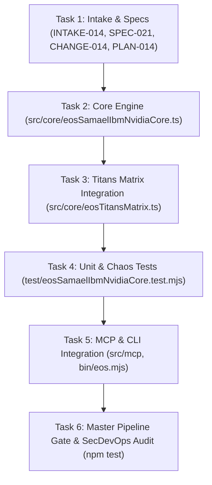

# ATOMIC TASK DAG: SAMAELIAN CYBER-THEURGIC SYNTHESIS — IBM & NVIDIA (TASKS-014)

## Task Checklist
- [x] Task 1: Record Intake, Specification, Change Proposal, and ADR.
- [ ] Task 2: Implement `EosSamaelIbmNvidiaCore` with Octaves, IBM Sysplex 2PC, and NVIDIA CUDA Warp Scheduler.
- [ ] Task 3: Expand `src/core/eosTitansMatrix.ts` with IBM Sysplex Seven-Nines benchmark.
- [ ] Task 4: Author test suite `test/eosSamaelIbmNvidiaCore.test.mjs` verifying BDD-051.
- [ ] Task 5: Expose in MCP server and CLI.
- [ ] Task 6: Verify 7/7 stages in `scripts/verify-cicd-pipeline.mjs` with exit code 0.
