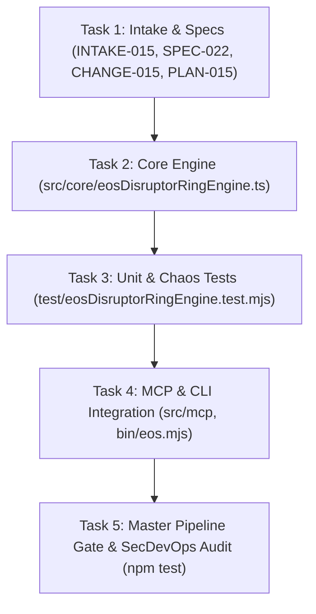

# ATOMIC TASK DAG: LMAX DISRUPTOR RING BUFFER & NANOSECOND OPTIMIZATION (TASKS-015)

## Task Checklist
- [x] Task 1: Record Intake, Specification, Change Proposal, and ADR.
- [ ] Task 2: Implement `EosDisruptorRingEngine` with power-of-2 ring buffer, 64-byte padding, and byte scanner.
- [ ] Task 3: Author test suite `test/eosDisruptorRingEngine.test.mjs` verifying BDD-052.
- [ ] Task 4: Expose in MCP server and CLI (`eos disruptor`).
- [ ] Task 5: Verify 7/7 stages in `scripts/verify-cicd-pipeline.mjs` with exit code 0.
