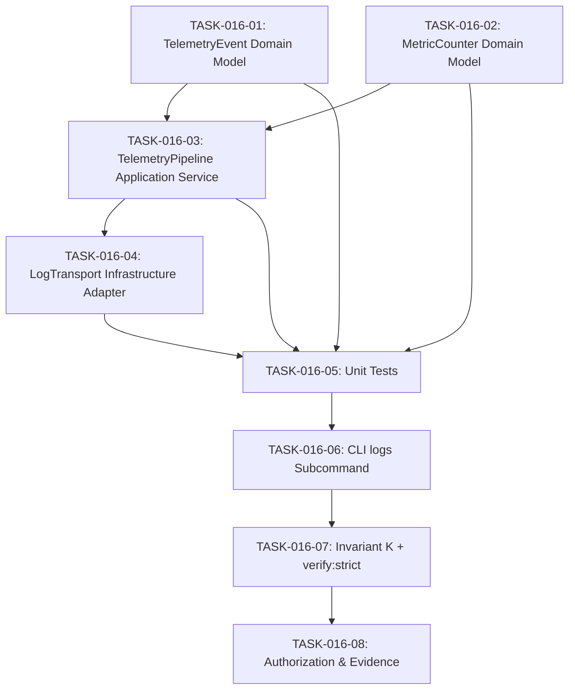

# TASKS-016: Observability & Telemetry Pipeline — Atomic Task DAG

## Status: APPROVED
## Date: 2026-10-25

---

## Task DAG

---

## TASK-016-01: Implement `TelemetryEvent.ts` Domain Model
- **Layer:** Domain (L0 Pure)
- **Dependencies:** None
- **Done Criteria:** File exists at `src/core/domain/models/TelemetryEvent.ts` with zero external imports, severity enum, event creation factory, JSON serialization, correlation ID support, and `Object.freeze()` immutability.

## TASK-016-02: Implement `MetricCounter.ts` Domain Model
- **Layer:** Domain (L0 Pure)
- **Dependencies:** None
- **Done Criteria:** File exists at `src/core/domain/models/MetricCounter.ts` with counter/gauge/histogram metric types, increment/decrement/observe operations, dimensional label support, and snapshot export.

## TASK-016-03: Implement `TelemetryPipeline.ts` Application Service
- **Layer:** Application (L1)
- **Dependencies:** TASK-016-01, TASK-016-02
- **Done Criteria:** File exists at `src/core/application/TelemetryPipeline.ts` with subscriber registration, severity filtering, transport dispatch, flush/drain, and correlation context management.

## TASK-016-04: Implement `LogTransport.ts` Infrastructure Adapter
- **Layer:** Infrastructure (L2)
- **Dependencies:** TASK-016-03
- **Done Criteria:** File exists at `src/infrastructure/LogTransport.ts` with `ILogTransport` interface, `StdoutTransport` and `FileTransport` implementations, NDJSON formatting.

## TASK-016-05: Implement Unit Tests
- **Layer:** Test
- **Dependencies:** TASK-016-01, TASK-016-02, TASK-016-03
- **Done Criteria:** `tests/unit/domain/TelemetryEvent.test.ts` and `tests/unit/domain/MetricCounter.test.ts` with 100% passing. `tests/unit/application/TelemetryPipeline.test.ts` with pipeline subscriber and filtering tests.

## TASK-016-06: Integrate CLI `logs` Subcommand
- **Layer:** CLI (L3)
- **Dependencies:** TASK-016-05
- **Done Criteria:** `scripts/eos-cli.mjs` updated with `logs` command supporting `tail`, `search`, and `export` subcommands.

## TASK-016-07: Add Invariant K to `verify-strict.ps1`
- **Layer:** Verification
- **Dependencies:** TASK-016-06
- **Done Criteria:** Invariant K validates TelemetryEvent domain model creation, severity ordering, and JSON serialization via Node.js inline execution.

## TASK-016-08: Update Authorization & Exports
- **Layer:** Governance
- **Dependencies:** TASK-016-07
- **Done Criteria:** `IMPLEMENTATION_AUTHORIZATION.md` updated with AUTH-016. `src/index.ts` exports new modules. `npm run verify:strict` → Exit Code 0.
