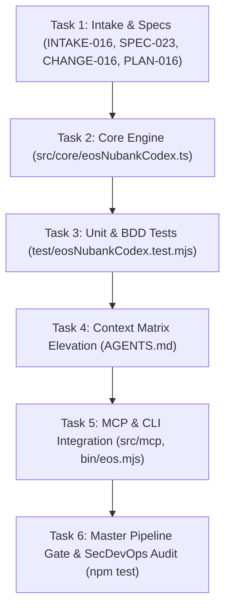

# ATOMIC TASK DAG: NUBANK INSTITUTIONAL ENGINEERING CODEX (TASKS-016)

## Task Checklist
- [x] Task 1: Record Intake, Specification, Change Proposal, and ADR.
- [x] Task 2: Implement `src/core/eosNubankCodex.ts` with 6 Building Nu pillars.
- [x] Task 3: Author test suite `test/eosNubankCodex.test.mjs` verifying BDD-053.
- [x] Task 4: Elevate `AGENTS.md` with Nubank Institutional Doctrine.
- [x] Task 5: Expose in MCP server and CLI (`eos nubank`).
- [x] Task 6: Verify 7/7 stages in `scripts/verify-cicd-pipeline.mjs` with exit code 0.
