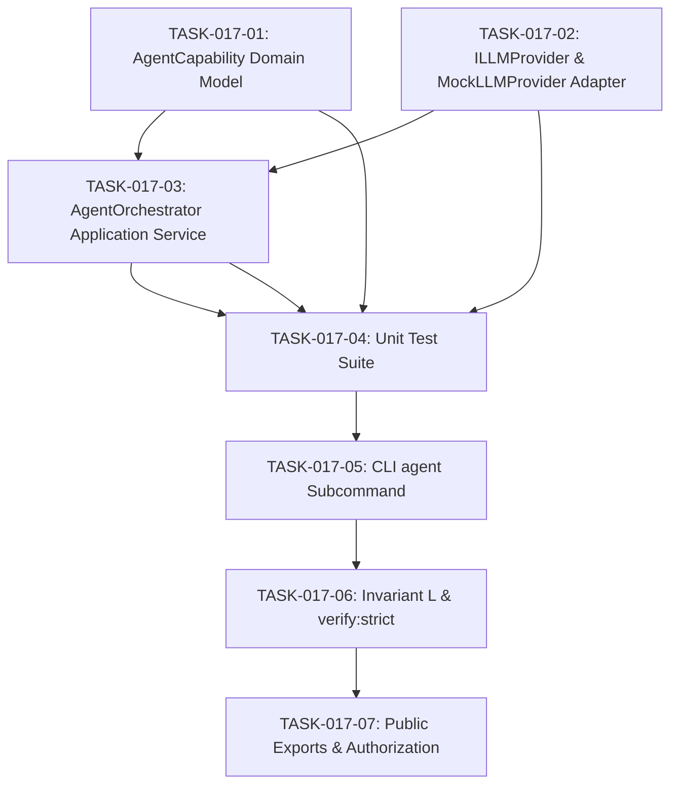

# TASKS-017: Autonomous Agent Orchestrator — Atomic Task DAG

## Status: APPROVED
## Date: 2026-10-25

---

## Task DAG

---

## TASK-017-01: Implement `AgentCapability.ts` Domain Model
- **Layer:** Domain (L0 Pure)
- **Dependencies:** None
- **Done Criteria:** File exists at `src/core/domain/models/AgentCapability.ts` with zero external imports, `AgentPersona` enum, `AgentCapability` class with immutability, validation of input/output contracts, and standard capability catalog presets.

## TASK-017-02: Implement `LLMProvider.ts` Infrastructure Adapter
- **Layer:** Infrastructure (L2)
- **Dependencies:** None
- **Done Criteria:** File exists at `src/infrastructure/LLMProvider.ts` defining `ILLMProvider`, `LLMRequest`, `LLMResponse`, `MockLLMProvider`, and provider factory.

## TASK-017-03: Implement `AgentOrchestrator.ts` Application Service
- **Layer:** Application (L1)
- **Dependencies:** TASK-017-01, TASK-017-02
- **Done Criteria:** File exists at `src/core/application/AgentOrchestrator.ts` executing step plans, collecting reasoning traces, integrating with `TelemetryPipeline`, and maintaining run history.

## TASK-017-04: Implement Unit Tests
- **Layer:** Test
- **Dependencies:** TASK-017-01, TASK-017-02, TASK-017-03
- **Done Criteria:** `tests/unit/domain/AgentCapability.test.ts` and `tests/unit/application/AgentOrchestrator.test.ts` pass with 100% of assertions succeeding.

## TASK-017-05: CLI `agent` Subcommand Integration
- **Layer:** CLI (L3)
- **Dependencies:** TASK-017-04
- **Done Criteria:** `scripts/eos-cli.mjs` supports `agent run "<instruction>"`, `agent capabilities`, and `agent status`.

## TASK-017-06: Invariant L in `verify-strict.ps1`
- **Layer:** Verification
- **Dependencies:** TASK-017-05
- **Done Criteria:** Invariant L added to `scripts/verify-strict.ps1` testing capability validation and orchestrator mock execution.

## TASK-017-07: Update Authorization & Exports
- **Layer:** Governance
- **Dependencies:** TASK-017-06
- **Done Criteria:** `IMPLEMENTATION_AUTHORIZATION.md` updated with AUTH-017. `src/index.ts` exports new modules. `npm test` passes with Exit Code 0.
