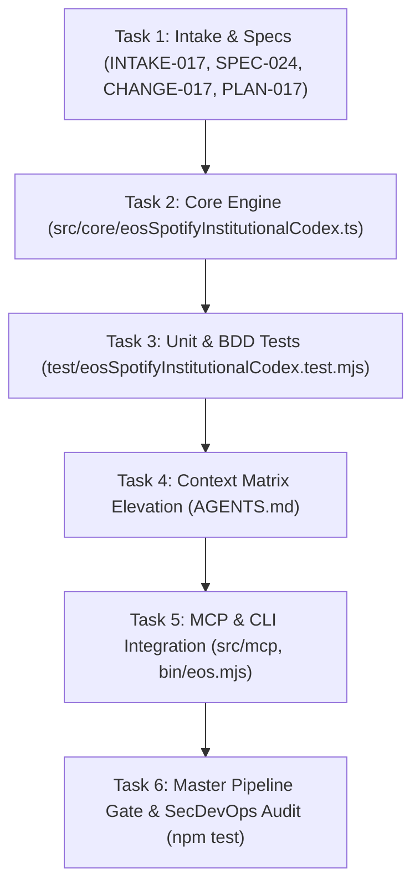

# ATOMIC TASK DAG: SPOTIFY INSTITUTIONAL ENGINEERING CODEX (TASKS-017)

## Task Checklist
- [x] Task 1: Record Intake, Specification, Change Proposal, and ADR.
- [x] Task 2: Implement `src/core/eosSpotifyInstitutionalCodex.ts` with 6 Spotify Engineering pillars.
- [x] Task 3: Author test suite `test/eosSpotifyInstitutionalCodex.test.mjs` verifying BDD-054.
- [x] Task 4: Elevate `AGENTS.md` with Spotify Institutional Doctrine.
- [x] Task 5: Expose in MCP server and CLI (`eos spotify:institutional`).
- [x] Task 6: Verify 7/7 stages in `scripts/verify-cicd-pipeline.mjs` with exit code 0.
