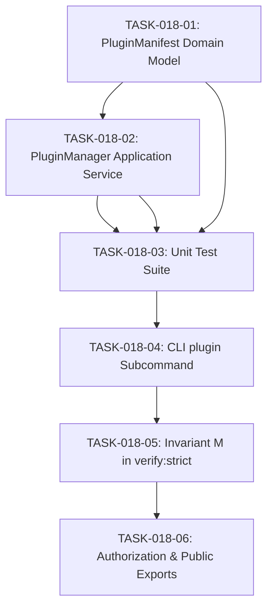

# TASKS-018: Plugin & Extension System — Atomic Task DAG

## Status: APPROVED
## Date: 2026-10-25

---

## Task DAG

---

## TASK-018-01: Implement `PluginManifest.ts` Domain Model
- **Layer:** Domain (L0 Pure)
- **Dependencies:** None
- **Done Criteria:** File exists at `src/core/domain/models/PluginManifest.ts` with zero external imports, `PluginHookType` definitions, SemVer validation, and full immutability.

## TASK-018-02: Implement `PluginManager.ts` Application Service
- **Layer:** Application (L1)
- **Dependencies:** TASK-018-01
- **Done Criteria:** File exists at `src/core/application/PluginManager.ts` providing registration, listing, hook execution with error containment, and telemetry integration.

## TASK-018-03: Implement Unit Tests
- **Layer:** Test
- **Dependencies:** TASK-018-01, TASK-018-02
- **Done Criteria:** `tests/unit/domain/PluginManifest.test.ts` and `tests/unit/application/PluginManager.test.ts` pass with 100% assertions succeeding.

## TASK-018-04: Integrate CLI `plugin` Subcommand
- **Layer:** CLI (L3)
- **Dependencies:** TASK-018-03
- **Done Criteria:** `scripts/eos-cli.mjs` supports `eos plugin list`, `eos plugin create <name>`, and `eos plugin status`.

## TASK-018-05: Invariant M in `verify-strict.ps1`
- **Layer:** Verification
- **Dependencies:** TASK-018-04
- **Done Criteria:** Invariant M added to `scripts/verify-strict.ps1` validating plugin manifest instantiation and hook dispatch.

## TASK-018-06: Update Authorization & Public Exports
- **Layer:** Governance
- **Dependencies:** TASK-018-05
- **Done Criteria:** `IMPLEMENTATION_AUTHORIZATION.md` updated with AUTH-018. `src/index.ts` exports new modules. `npm test` passes with Exit Code 0.
