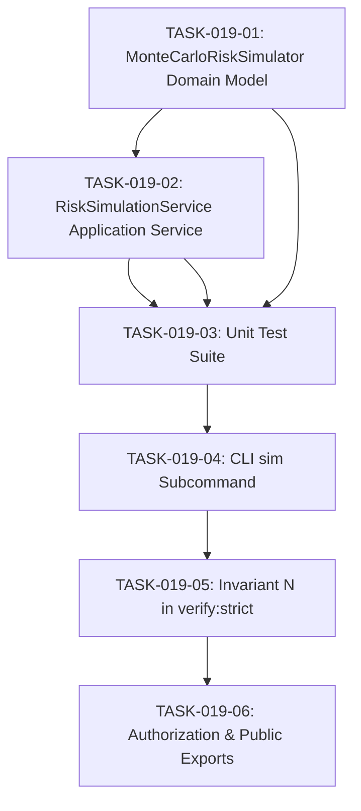

# TASKS-019: Monte Carlo Risk Simulation Engine — Atomic Task DAG

## Status: APPROVED
## Date: 2026-10-25

---

## Task DAG

---

## TASK-019-01: Implement `MonteCarloRiskSimulator.ts` Domain Model
- **Layer:** Domain (L0 Pure)
- **Dependencies:** None
- **Done Criteria:** File exists at `src/core/domain/models/MonteCarloRiskSimulator.ts` with zero external imports, Mulberry32 PRNG, Beta-PERT stochastic sampling, percentile calculations (P10, P50, P80, P90, P95, P99), and deadline probability.

## TASK-019-02: Implement `RiskSimulationService.ts` Application Service
- **Layer:** Application (L1)
- **Dependencies:** TASK-019-01
- **Done Criteria:** File exists at `src/core/application/RiskSimulationService.ts` running simulations on task breakdowns, telemetry emission, and ASCII distribution formatting.

## TASK-019-03: Implement Unit Tests
- **Layer:** Test
- **Dependencies:** TASK-019-01, TASK-019-02
- **Done Criteria:** `tests/unit/domain/MonteCarloRiskSimulator.test.ts` with 100% test pass rate verifying percentiles, seeding, and execution bounds.

## TASK-019-04: Integrate CLI `sim` Subcommand
- **Layer:** CLI (L3)
- **Dependencies:** TASK-019-03
- **Done Criteria:** `scripts/eos-cli.mjs` supports `eos sim [iterations] [deadline]`.

## TASK-019-05: Invariant N in `verify-strict.ps1`
- **Layer:** Verification
- **Dependencies:** TASK-019-04
- **Done Criteria:** Invariant N added to `scripts/verify-strict.ps1` testing Monte Carlo simulation execution and percentile ordering.

## TASK-019-06: Update Authorization & Public Exports
- **Layer:** Governance
- **Dependencies:** TASK-019-05
- **Done Criteria:** `IMPLEMENTATION_AUTHORIZATION.md` updated with AUTH-019. `src/index.ts` exports new modules. `npm test` passes with Exit Code 0.
