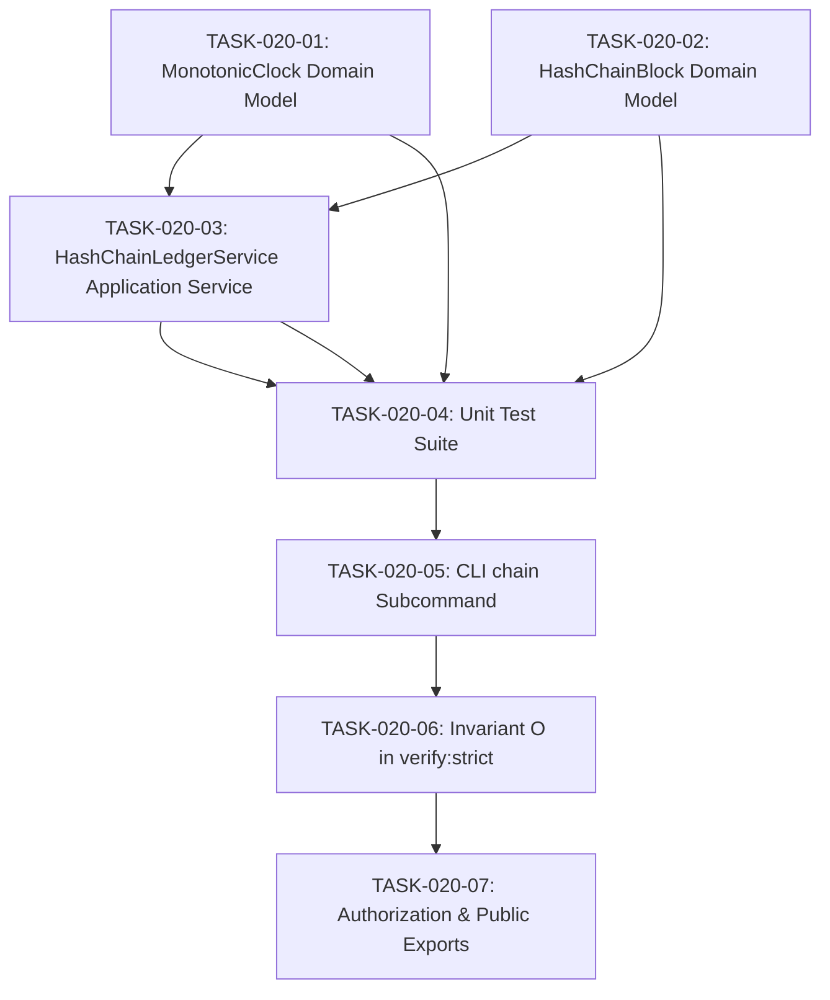

# TASKS-020: Monotonic Clock & Hash-Chain Ledger — Atomic Task DAG

## Status: APPROVED
## Date: 2026-10-25

---

## Task DAG

---

## TASK-020-01: Implement `MonotonicClock.ts` Domain Model
- **Layer:** Domain (L0 Pure)
- **Dependencies:** None
- **Done Criteria:** File exists at `src/core/domain/models/MonotonicClock.ts` with zero external imports, monotonic progression guarantees, and nanosecond duration calculations.

## TASK-020-02: Implement `HashChainBlock.ts` Domain Model
- **Layer:** Domain (L0 Pure)
- **Dependencies:** None
- **Done Criteria:** File exists at `src/core/domain/models/HashChainBlock.ts` defining immutable chain block entity, hash computation logic, genesis creation, and full chain verification algorithm.

## TASK-020-03: Implement `HashChainLedgerService.ts` Application Service
- **Layer:** Application (L1)
- **Dependencies:** TASK-020-01, TASK-020-02
- **Done Criteria:** File exists at `src/core/application/HashChainLedgerService.ts` providing append block, verify chain, persist ledger, and emit telemetry.

## TASK-020-04: Implement Unit Tests
- **Layer:** Test
- **Dependencies:** TASK-020-01, TASK-020-02, TASK-020-03
- **Done Criteria:** `tests/unit/domain/MonotonicClock.test.ts` and `tests/unit/domain/HashChainBlock.test.ts` pass with 100% assertions.

## TASK-020-05: Integrate CLI `chain` Subcommand
- **Layer:** CLI (L3)
- **Dependencies:** TASK-020-04
- **Done Criteria:** `scripts/eos-cli.mjs` supports `eos chain [verify|status|add]`.

## TASK-020-06: Invariant O in `verify-strict.ps1`
- **Layer:** Verification
- **Dependencies:** TASK-020-05
- **Done Criteria:** Invariant O added to `scripts/verify-strict.ps1` validating monotonic timestamps, hash-chain generation, and tamper detection.

## TASK-020-07: Update Authorization & Public Exports
- **Layer:** Governance
- **Dependencies:** TASK-020-06
- **Done Criteria:** `IMPLEMENTATION_AUTHORIZATION.md` updated with AUTH-020. `src/index.ts` exports new modules. `npm test` passes with Exit Code 0.
