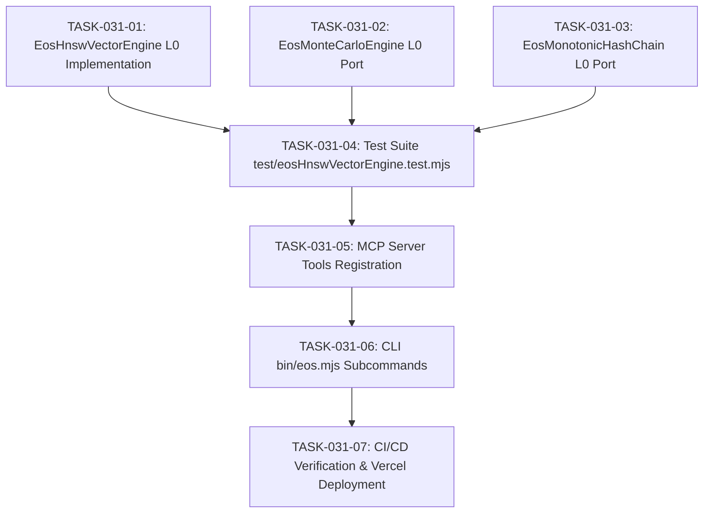

# TASKS-031: PALANTIR HNSW VECTOR REASONING & ALADDIN RISK LEDGER — ATOMIC DAG

## Task DAG

## Tasks
- **TASK-031-01**: Implement `src/core/eosHnswVectorEngine.ts` (Cosine, L2, deterministic token embedding projection, HNSW graph).
- **TASK-031-02**: Implement `src/core/eosMonteCarloEngine.ts` (Mulberry32 PRNG, Beta-PERT, P10-P99 percentiles).
- **TASK-031-03**: Implement `src/core/eosMonotonicHashChain.ts` (Monotonic timestamping, pure SHA-256 block chaining, tamper detection).
- **TASK-031-04**: Implement unit tests in `test/eosHnswVectorEngine.test.mjs`.
- **TASK-031-05**: Register `eos_hnsw_index_add`, `eos_hnsw_knn_search`, `eos_vector_similarity`, `eos_monte_carlo_sim`, `eos_hash_chain_verify` in MCP server.
- **TASK-031-06**: Integrate CLI subcommands `vector`, `sim`, and `chain` in `bin/eos.mjs`.
- **TASK-031-07**: Execute full 7-stage CI/CD gate and deploy to Vercel production.
