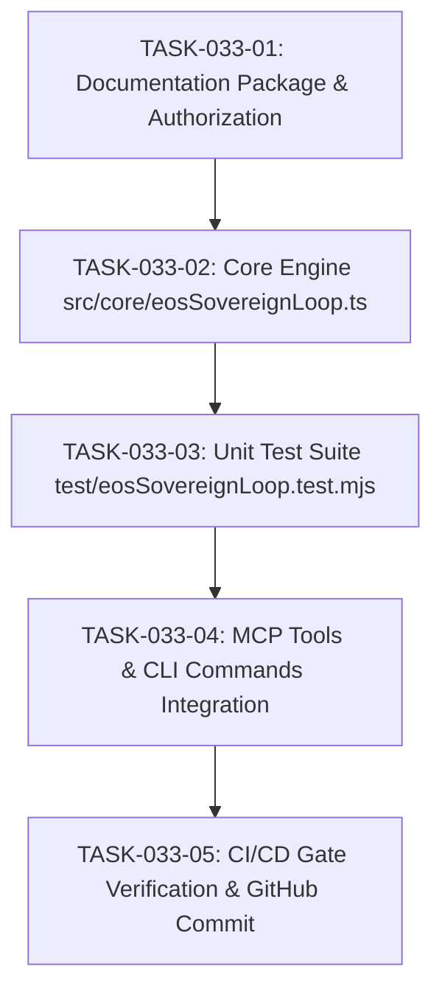

# TASKS-033: 21-STEP AUTONOMOUS SOVEREIGN ENGINEERING LOOP ENGINE — ATOMIC DAG

## Task DAG

## Tasks
- **TASK-033-01**: Generate `INTAKE-033`, `SPEC-040`, `PLAN-033`, `TASKS-033`, `CHANGE-033`, and authorization in `IMPLEMENTATION_AUTHORIZATION.md`.
- **TASK-033-02**: Implement `src/core/eosSovereignLoop.ts` with 21 pipeline stages, state transitions, EARS synthesis, BDD mapping, and evidence sealing.
- **TASK-033-03**: Create unit test suite `test/eosSovereignLoop.test.mjs`.
- **TASK-033-04**: Register MCP tools and CLI subcommand `loop` in `bin/eos.mjs`.
- **TASK-033-05**: Run 7-stage CI/CD gate, commit to git, and push to GitHub.
