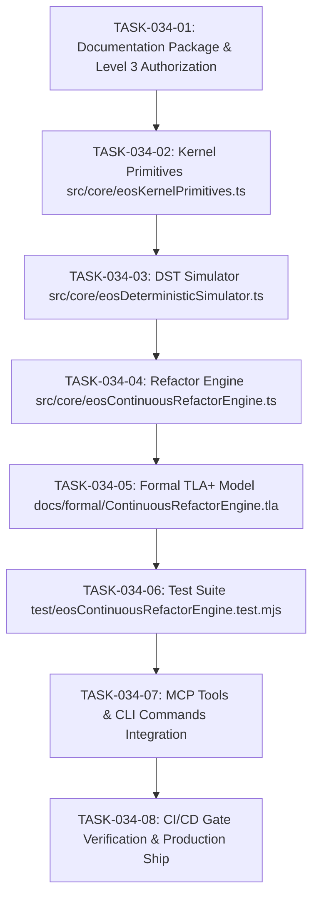

# TASKS-034: AUTONOMOUS CONTINUOUS REFACTORING ENGINE — ATOMIC DAG

## Task DAG

## Tasks
- **TASK-034-01**: Generate `INTAKE-034`, `SPEC-041`, `PLAN-034`, `TASKS-034`, `CHANGE-034`, and authorization in `IMPLEMENTATION_AUTHORIZATION.md`.
- **TASK-034-02**: Verify and refine `src/core/eosKernelPrimitives.ts` (DbC assertions, deepFreeze, pure crypto, Mulberry32, Result).
- **TASK-034-03**: Implement `src/core/eosDeterministicSimulator.ts` (Deterministic Simulation Testing with seed-based fault injection and 100% microsecond reproducibility).
- **TASK-034-04**: Enhance `src/core/eosContinuousRefactorEngine.ts` (AST duplication, dead code, complexity bottlenecks, daemon mode).
- **TASK-034-05**: Create formal TLA+ specification `docs/formal/ContinuousRefactorEngine.tla` and wire into `scripts/verify-formal-tla.mjs`.
- **TASK-034-06**: Implement native test suite `test/eosContinuousRefactorEngine.test.mjs` validating BDD-114 to BDD-118.
- **TASK-034-07**: Register MCP tools and CLI commands in `src/mcp/eosMcpServer.ts` and `bin/eos.mjs`.
- **TASK-034-08**: Run 7-stage CI/CD gate, ship sovereign release to production, and verify live on Vercel.
