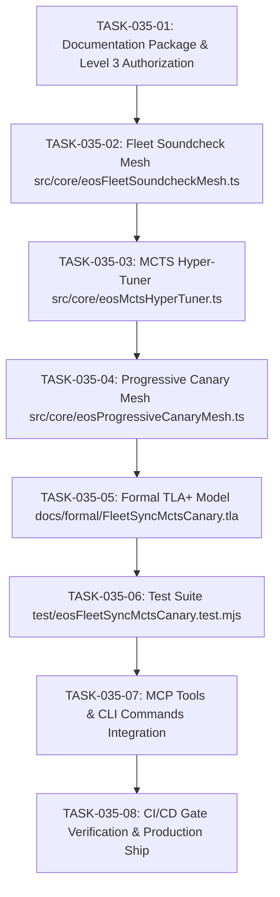

# TASKS-035: SOVEREIGN FLEET SOUNDCHECK, MCTS & CANARY MESH — ATOMIC DAG

## Task DAG

## Tasks
- **TASK-035-01**: Generate `INTAKE-035`, `SPEC-042`, `PLAN-035`, `TASKS-035`, `CHANGE-035`, and authorization in `IMPLEMENTATION_AUTHORIZATION.md`.
- **TASK-035-02**: Implement `src/core/eosFleetSoundcheckMesh.ts` (Soundcheck 0-100, health audit, remediation advice).
- **TASK-035-03**: Implement `src/core/eosMctsHyperTuner.ts` (MCTS with UCT, parameter search).
- **TASK-035-04**: Implement `src/core/eosProgressiveCanaryMesh.ts` (Canary 1-5-25-100%, error budget rollback).
- **TASK-035-05**: Implement formal TLA+ model `docs/formal/FleetSyncMctsCanary.tla` and wire into `scripts/verify-formal-tla.mjs`.
- **TASK-035-06**: Implement native test suite `test/eosFleetSyncMctsCanary.test.mjs` validating BDD-119 through BDD-123.
- **TASK-035-07**: Register MCP tools and CLI commands in `src/mcp/eosMcpServer.ts` and `bin/eos.mjs`.
- **TASK-035-08**: Run 7-stage CI/CD gate, ship sovereign release to production, and verify live on Vercel.
